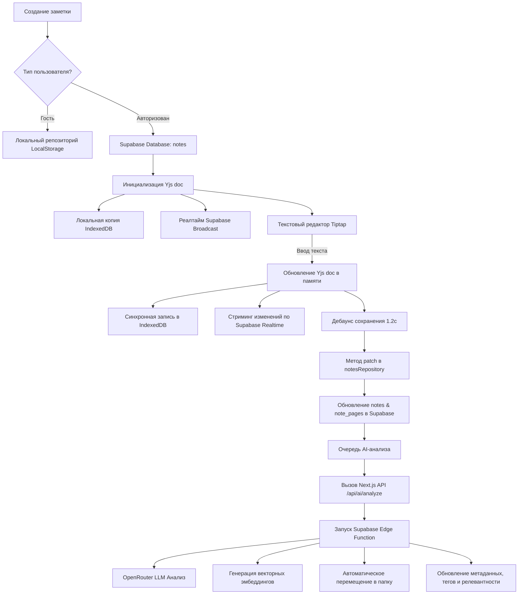

# Жизненный цикл заметки в SmartNotes-ai

В этом документе подробно описан жизненный цикл заметки с момента её создания до удаления, включая механизмы локального кэширования, совместной работы в реальном времени, долговременного сохранения и автоматического AI-анализа.

---

## 1. Создание заметки (Creation)

Заметка создается через метод `createNote` в хуке [useNoteActions](file:///c:/Users/TopMob/Documents/Projects/TopMob/SmartNotes-ai/src/features/notes/hooks/use-note-mutations.ts#L224). 
1. Формируется черновик `NoteDraft` (заголовок, содержимое, теги, папка).
2. Вызывается мутация `useCreateNoteMutation`.
3. Определяется область видимости пользователя:
   - **Гость (Guest)**: Заметка сохраняется локально в браузере в `LocalStorage` с префиксом `smartnotes:local:notes:guest`.
   - **Авторизован**: Заметка отправляется в Supabase в таблицу `notes` через `notesRepository.create`.
4. Вместе с заметкой создаются её страницы в дочерней таблице `note_pages` (по умолчанию одна страница с начальным текстом).
5. При успешном создании:
   - Заметка ставится в очередь локальной оффлайн-синхронизации `enqueueSyncItem`.
   - Планируется первый автоматический AI-анализ заметки `scheduleAiAnalysis`.

---

## 2. Локальное хранилище и Реалтайм-коллаборация (Yjs & IndexedDB & Realtime)

При открытии заметки в интерфейсе [EditorOverlay](file:///c:/Users/TopMob/Documents/Projects/TopMob/SmartNotes-ai/src/features/app-shell/ui/components/EditorOverlay.tsx) инициализируется сессия совместной работы через [NoteCollabSessionProvider](file:///c:/Users/TopMob/Documents/Projects/TopMob/SmartNotes-ai/src/features/editor-collab/hooks/use-note-collab-session.tsx#L63).

### А. Фаза гидратации (Hydration)
- Статус сессии устанавливается в `"hydrating"`. В этот момент на экране отображается экран загрузки, а редактор заблокирован, предотвращая перезапись данных пустым состоянием.
- Создается локальный инстанс документа Yjs `Y.Doc`.
- Инициализируется локальный провайдер базы данных IndexedDB (`y-indexeddb`), который считывает историю изменений этой заметки из локальной памяти браузера.
- Инициализируется Supabase Realtime канал `bindYjsSupabaseChannel` для прослушивания Broadcast-сообщений от других пользователей, редактирующих эту же заметку.
- Если в IndexedDB есть данные страниц, они применяются. Если IndexedDB пуст, Yjs документ наполняется структурой из кэша React Query (`note.pages`), полученного из базы данных.
- Статус переходит в `"ready"`, и Tiptap-редактор наполняется актуальным HTML-контентом.

### Б. Процесс редактирования
- Каждое нажатие клавиши в Tiptap триггерит событие `onUpdate`.
- Это событие вызывает `setPageContent(pageId, html)`, которое синхронно записывает изменения в локальный Yjs-документ в памяти с транзакцией `"note-doc:set-page-content"`.
- Yjs автоматически сохраняет это изменение в IndexedDB (что гарантирует сохранность данных при внезапном закрытии вкладки или отключении интернета).
- Изменение мгновенно транслируется другим участникам через Supabase Realtime Broadcast.
- **Оптимизация производительности**: Чтобы интерфейс не зависал при быстром вводе текста, обновление состояния React (`setSnapshot`) при транзакции ввода текста дебаунсится на **1 секунду**. Все остальные события (смена страниц, загрузка, переименование) обрабатываются мгновенно.

---

## 3. Долговременное сохранение (Durable Note Save)

Чтобы не нагружать сервер базовыми запросами при каждом нажатии клавиши, запись в основную базу данных Supabase дебаунсится:
1. Каждое изменение Yjs-документа запускает таймер дебаунса на **1.2 секунды** (`NOTE_COLLAB_SAVE_DEBOUNCE_MS`).
2. По истечении таймера вызывается метод `flush()` в хуке [useDurableNoteSave](file:///c:/Users/TopMob/Documents/Projects/TopMob/SmartNotes-ai/src/features/editor-collab/hooks/use-durable-note-save.ts#L78).
3. Из Yjs-документа считывается текущий снимок заметки (заголовок, папка, теги, страницы, объединенный текст).
4. Если данные изменились по сравнению с последним сохраненным снимком, формируется запрос и отправляется в `notesRepository.patch(noteId, patch)`.
5. В Supabase отправляются два запроса:
   - Обновление основной информации в таблице `notes` (заголовок, объединенный текст, папка, пользовательские теги, время обновления).
   - Обновление структуры страниц в таблице `note_pages` (старые страницы удаляются, новые страницы с актуальным текстом и рисунками вставляются).
6. После успешной записи статус `durableState` переходит в `"saved"`.

---

## 4. Автоматический AI-анализ (AI Analysis Queue)

AI-анализ выполняется полностью в фоновом режиме через специализированную глобальную очередь:
1. При запуске приложения в [DataBootstrap](file:///c:/Users/TopMob/Documents/Projects/TopMob/SmartNotes-ai/src/features/bootstrap/ui/data-bootstrap.tsx) инициализируется фоновый планировщик `startBackgroundAiScheduler()`.
2. Компонент `DataBootstrap` непрерывно отслеживает список заметок. Если обнаруживаются неактуализированные или новые заметки (где `note.analyzed === false` и `aiStatus` не находится в состоянии `"pending"`, `"analyzing"` или `"error"`), их идентификаторы автоматически ставятся в очередь через функцию `scheduleAiAnalysis(noteId)`.
3. Очередь управляется модулем [ai-queue.ts](file:///c:/Users/TopMob/Documents/Projects/TopMob/SmartNotes-ai/src/services/ai/ai-queue.ts) и сохраняется в локальной памяти браузера `localStorage` под ключом `smartnotes:ai:pending`. Это гарантирует, что очередь не потеряется при случайном закрытии вкладки или перезагрузке страницы.
4. Очередь обрабатывается строго **последовательно (sequentially)**:
   - Клиент отправляет POST-запрос на Next.js API-роут `/api/ai/analyze`, передавая `noteId`.
   - API-роут валидирует сессию пользователя и вызывает Supabase Edge Function `analyze-note` по защищенному каналу.
   - Edge-функция обращается к OpenRouter LLM, генерирует структурированные данные (краткую сводку, теги `userTags` и `hiddenTags`, подбирает релевантную папку через RPC `match_folder` и рассчитывает `relevance`/`resurfacingClass`), а также генерирует векторные эмбеддинги для таблицы `note_embeddings`.
5. По завершении анализа текущей заметки:
   - Идентификатор заметки удаляется из очереди и `localStorage`.
   - Публикуется глобальное событие `syncCompleted` через внутренний `EventBus`.
   - `DataBootstrap` перехватывает это событие и инвалидирует кэш React Query для запроса `"notes"`, благодаря чему интерфейс мгновенно и плавно обновляется без ручной перезагрузки.
6. **Оптимизация и стабильность**:
   - Между запросами в очереди выдерживается обязательная пауза в **1.5 секунды**, что защищает API OpenRouter и Supabase Edge Functions от превышения лимитов запросов (rate limits).
   - При потере интернет-соединения очередь автоматически приостанавливает обработку и возобновляет её сразу после возвращения в сеть (по событию `online`).

---

## 5. Добавление медиафайлов и рисунков (Media & Sketching)

### Рисунки (Sketching)
- Пользователь открывает холст для рисования `DrawingCanvas`.
- Рисунок сохраняется как Base64 DataURL.
- DataURL записывается в поле `drawingDataUrl` текущей страницы Yjs-документа и увеличивает `drawingRevision`.
- При сохранении это поле записывается в `note_pages` в базе данных.

### Медиафайлы (Media Upload & Zero-Base64 IndexedDB Fallback)
- При выборе файла или его вставке из буфера вызывается `uploadMediaFile`.
- **Клиентское сжатие (Client-side Compression)**: Изображение предварительно сжимается на клиенте с помощью легковесной Canvas-утилиты [image-compression.ts](file:///c:/Users/TopMob/Documents/Projects/TopMob/SmartNotes-ai/src/shared/utils/image-compression.ts). Оно приводится к разрешению до 1200px по ширине/высоте и сохраняется в формате JPEG с качеством 0.8. Это позволяет уменьшить вес медиафайла до уровня **<500KB**, экономя трафик пользователя и место на сервере.
- **Стратегия выбора хранилища**:
  1. **Google Drive (BYOS)**: По умолчанию приложение пытается загрузить сжатый файл в Google Drive пользователя через Next.js Proxy. Если пользователь сталкивается с постоянными проблемами авторизации или токенов, он может полностью отключить интеграцию с Google Drive в настройках приложения (переключатель сохраняется локально как `smartnotes:disable-google-drive`).
  2. **Supabase Storage**: Если интеграция с Google Drive отключена в настройках или её вызов завершился ошибкой, файл загружается в объектное хранилище **Supabase Storage** в бакет `note-images`. Путь к файлу формируется с использованием уникального UUID пользователя (`${userId}/${randomName}`).
  3. **Локальный фолбек (IndexedDB Blob Fallback)**: Если пользователь не авторизован (гостевая сессия), работает оффлайн или облачные хранилища недоступны, сжатый медиафайл сохраняется напрямую в виде **бинарного Blob** в IndexedDB (база данных `smartnotes-local-media`, объектное хранилище `media`) под уникальным ключом `fileId`. В объект заметки (JSON/HTML) записывается исключительно короткий текстовый идентификатор вида `local-media:fileId`. Хранение тяжелых Base64-строк в JSON/HTML полностью исключено, что защищает производительность и предотвращает переполнение лимитов `localStorage` (или квот IndexedDB).
- **Динамический рендеринг и A11y**: При загрузке и рендере контента в редакторе кастомное расширение Tiptap `LocalMediaImageExtension` перехватывает ссылки `local-media:fileId`, асинхронно извлекает бинарный Blob из IndexedDB и превращает его в сессионную ссылку `blob:http://...` через `URL.createObjectURL(blob)`, которая автоматически очищается (revoke) при уничтожении NodeView для исключения утечек памяти.
- **Автоматическая миграция (Base64 Auto-Migration)**: Для полной ликвидации Base64-изображений из старых данных, при открытии любой старой заметки в редакторе Tiptap автоматически парсит и на лету конвертирует любые найденные `data:image/` (Base64) в бинарные Blob, сохраняет их в IndexedDB, заменяет ссылку в теле заметки на `local-media:fileId` и отправляет чистую заметку в автосохранение, бесследно и безвозвратно вычищая старый Base64 из базы данных.

---

## 6. Удаление заметки (Deletion)

1. **Мягкое удаление (Trash)**:
   - Метод `trashNote` устанавливает поле `trashed_at` в текущее время.
   - Заметка скрывается из основного списка и отображается в разделе «Корзина».
   - AI-анализ для такой заметки временно приостанавливается.
2. **Восстановление (Restore)**:
   - Метод `restoreNote` сбрасывает `trashed_at` в `null`. Заметка возвращается в исходную папку.
3. **Окончательное удаление (Permanent Delete)**:
   - Метод `permanentlyDeleteNote` вызывает `notesRepository.remove`.
   - Запись удаляется из таблицы `notes`.
   - Благодаря каскадному удалению (`ON DELETE CASCADE`) в базе данных автоматически удаляются все связанные записи из таблиц `note_pages`, `note_embeddings`, `note_media` и `note_access`.
