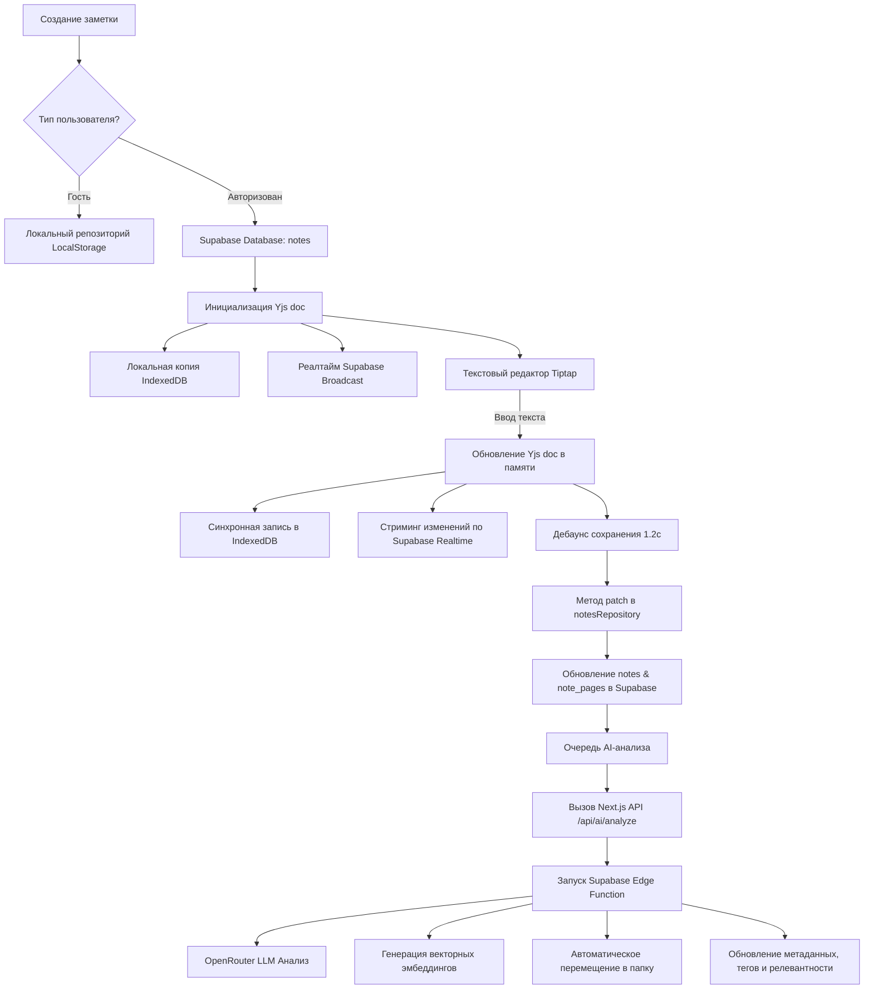

# Жизненный цикл заметки в SmartNotes-ai

В этом документе подробно описан жизненный цикл заметки с момента её создания до удаления, включая механизмы локального кэширования, совместной работы в реальном времени, долговременного сохранения и автоматического AI-анализа.

---

## 1. Создание заметки (Creation)

Заметка создается через метод `createNote` в хуке [useNoteActions](file:///c:/Users/TopMob/Documents/Projects/TopMob/SmartNotes-ai/src/features/notes/hooks/use-note-mutations.ts#L224). 
1. Формируется черновик `NoteDraft` (заголовок, содержимое, теги, папка).
2. Вызывается мутация `useCreateNoteMutation`.
3. Определяется область видимости пользователя:
   - **Гость (Guest)**: Заметка сохраняется локально в браузере в `LocalStorage` с префиксом `smartnotes:local:notes:guest`.
   - **Авторизован**: Заметка отправляется в Supabase в таблицу `notes` через `notesRepository.create`.
4. Вместе с заметкой создаются её страницы в дочерней таблице `note_pages` (по умолчанию одна страница с начальным текстом).
5. При успешном создании:
   - Заметка ставится в очередь локальной оффлайн-синхронизации `enqueueSyncItem`.
   - Планируется первый автоматический AI-анализ заметки `scheduleAiAnalysis`.

---

## 2. Локальное хранилище и Реалтайм-коллаборация (Yjs & IndexedDB & Realtime)

При открытии заметки в интерфейсе [EditorOverlay](file:///c:/Users/TopMob/Documents/Projects/TopMob/SmartNotes-ai/src/features/app-shell/ui/components/EditorOverlay.tsx) инициализируется сессия совместной работы через [NoteCollabSessionProvider](file:///c:/Users/TopMob/Documents/Projects/TopMob/SmartNotes-ai/src/features/editor-collab/hooks/use-note-collab-session.tsx#L63).

### А. Фаза гидратации (Hydration)
- Статус сессии устанавливается в `"hydrating"`. В этот момент на экране отображается экран загрузки, а редактор заблокирован, предотвращая перезапись данных пустым состоянием.
- Создается локальный инстанс документа Yjs `Y.Doc`.
- Инициализируется локальный провайдер базы данных IndexedDB (`y-indexeddb`), который считывает историю изменений этой заметки из локальной памяти браузера.
- Инициализируется Supabase Realtime канал `bindYjsSupabaseChannel` для прослушивания Broadcast-сообщений от других пользователей, редактирующих эту же заметку.
- Если в IndexedDB есть данные страниц, они применяются. Если IndexedDB пуст, Yjs документ наполняется структурой из кэша React Query (`note.pages`), полученного из базы данных.
- Статус переходит в `"ready"`, и Tiptap-редактор наполняется актуальным HTML-контентом.

### Б. Процесс редактирования
- Каждое нажатие клавиши в Tiptap триггерит событие `onUpdate`.
- Это событие вызывает `setPageContent(pageId, html)`, которое синхронно записывает изменения в локальный Yjs-документ в памяти с транзакцией `"note-doc:set-page-content"`.
- Yjs автоматически сохраняет это изменение в IndexedDB (что гарантирует сохранность данных при внезапном закрытии вкладки или отключении интернета).
- Изменение мгновенно транслируется другим участникам через Supabase Realtime Broadcast.
- **Оптимизация производительности**: Чтобы интерфейс не зависал при быстром вводе текста, обновление состояния React (`setSnapshot`) при транзакции ввода текста дебаунсится на **1 секунду**. Все остальные события (смена страниц, загрузка, переименование) обрабатываются мгновенно.

---

## 3. Долговременное сохранение (Durable Note Save)

Чтобы не нагружать сервер базовыми запросами при каждом нажатии клавиши, запись в основную базу данных Supabase дебаунсится:
1. Каждое изменение Yjs-документа запускает таймер дебаунса на **1.2 секунды** (`NOTE_COLLAB_SAVE_DEBOUNCE_MS`).
2. По истечении таймера вызывается метод `flush()` в хуке [useDurableNoteSave](file:///c:/Users/TopMob/Documents/Projects/TopMob/SmartNotes-ai/src/features/editor-collab/hooks/use-durable-note-save.ts#L78).
3. Из Yjs-документа считывается текущий снимок заметки (заголовок, папка, теги, страницы, объединенный текст).
4. Если данные изменились по сравнению с последним сохраненным снимком, формируется запрос и отправляется в `notesRepository.patch(noteId, patch)`.
5. В Supabase отправляются два запроса:
   - Обновление основной информации в таблице `notes` (заголовок, объединенный текст, папка, пользовательские теги, время обновления).
   - Обновление структуры страниц в таблице `note_pages` (старые страницы удаляются, новые страницы с актуальным текстом и рисунками вставляются).
6. После успешной записи статус `durableState` переходит в `"saved"`.

---

## 4. Автоматический AI-анализ (AI Analysis)

AI-анализ запускается автоматически при изменении текста или заголовка заметки:
1. Хук [useAutoAnalyze](file:///c:/Users/TopMob/Documents/Projects/TopMob/SmartNotes-ai/src/features/ai-engine/hooks/use-auto-analyze.ts) вешает дебаунс-таймер на **5 секунд** после последнего изменения контента.
2. Проверяется хэш SHA-256 текущего текста. Если хэш совпадает со сохраненным в `metadata.content_hash`, анализ пропускается (для экономии токенов).
3. Статус AI переводится в `"analyzing"`.
4. Клиент делает запрос на Next.js API-роут `/api/ai/analyze`, передавая ID заметки и текущие ключи авторизации/модели OpenRouter из серверного `.env`.
5. API-роут проверяет права доступа пользователя и вызывает Supabase Deno Edge Function `analyze-note` по защищенному каналу.
6. Edge-функция в фоновом режиме выполняет следующие шаги:
   - Получает текст заметки и список папок пользователя.
   - Делает запрос к OpenRouter (модель `gpt-4o-mini` или аналог) со специальным системным промптом.
   - Получает структурированный JSON с:
     - Краткой сводкой (summary - AI Insight).
     - Релевантностью (relevance: 0.0 - 1.0).
     - Семантическими тегами (userTags, hiddenTags).
     - Классом всплытия (resurfacingClass: task, idea, reference, archive).
   - Генерирует векторные эмбеддинги для контента и сохраняет их в `note_embeddings`.
   - На основе эмбеддинга сводки вызывает RPC-функцию `match_folder`, подбирая наиболее подходящую по смыслу папку (или создает системную папку по умолчанию, если совпадений нет).
   - Обновляет запись заметки в таблице `notes` (переводит `ai_status` в `"done"` или `"error"` при сбое).
7. Клиентское приложение получает обновление через кэш React Query и отображает AI Insight в действиях заметки, а процент релевантности — на карточке заметки.

---

## 5. Добавление медиафайлов и рисунков (Media & Sketching)

### Рисунки (Sketching)
- Пользователь открывает холст для рисования `DrawingCanvas`.
- Рисунок сохраняется как Base64 DataURL.
- DataURL записывается в поле `drawingDataUrl` текущей страницы Yjs-документа и увеличивает `drawingRevision`.
- При сохранении это поле записывается в `note_pages` в базе данных.

### Медиафайлы (Media Upload)
- При выборе файла вызывается `uploadMediaFile`.
- Файл загружается в Google Drive (или хранится локально в `local-inline`, если интеграция не настроена).
- В таблице `note_media` создается запись с метаданными файла (название, ссылка, размер, mime-тип).
- Заметка обновляется, прикрепляя медиа-дескриптор.

---

## 6. Удаление заметки (Deletion)

1. **Мягкое удаление (Trash)**:
   - Метод `trashNote` устанавливает поле `trashed_at` в текущее время.
   - Заметка скрывается из основного списка и отображается в разделе «Корзина».
   - AI-анализ для такой заметки временно приостанавливается.
2. **Восстановление (Restore)**:
   - Метод `restoreNote` сбрасывает `trashed_at` в `null`. Заметка возвращается в исходную папку.
3. **Окончательное удаление (Permanent Delete)**:
   - Метод `permanentlyDeleteNote` вызывает `notesRepository.remove`.
   - Запись удаляется из таблицы `notes`.
   - Благодаря каскадному удалению (`ON DELETE CASCADE`) в базе данных автоматически удаляются все связанные записи из таблиц `note_pages`, `note_embeddings`, `note_media` и `note_access`.
